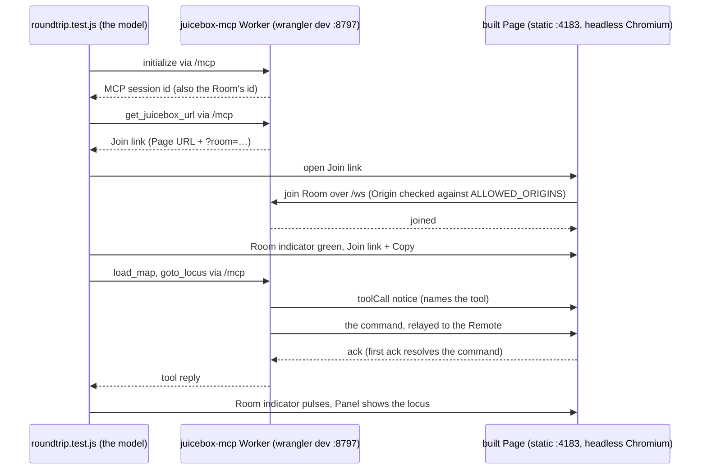

# The round trip

`npm run test:roundtrip` runs the whole system on one machine: the Page as it is deployed, a real juicebox-mcp Worker, and a test that plays the model. Following one run is a quick way to see how a model drives juicebox.js through MCP.

## Who is involved

- **The model's side.** In production this is Claude, an MCP client, calling the Worker's tools. In the round trip `roundtrip/model.js` takes its place: it sends the same JSON-RPC requests to `/mcp` that an MCP client sends.
- **The Worker.** It is juicebox-mcp's Cloudflare Worker, from weiszd/juicebox-mcp. It has two doors. MCP clients use `/mcp`, and Pages use `/ws`, a WebSocket. Behind them, a Durable Object per MCP session remembers which Room the session is bound to, and a Durable Object per Room holds the WebSockets of the Pages that joined it.
- **The Page.** It is this repo, built and served, running juicebox.js in a headless Chromium. Its Remote (`@aidenlab/juicebox-remote`) joins the Room, carries commands in to juicebox.js and sends acks back.

## One run



1. **The model gets an MCP session.** `initialize` returns an `mcp-session-id` header. The Worker uses that id as the Room's id too, so each conversation gets its own Room.
2. **The model asks for a Join link.** `get_juicebox_url` returns the Page's URL with `?room=<id>`. The Worker builds it from `BROWSER_URL`, which the round trip sets to `http://localhost:4183/`.
3. **The Page joins the Room.** It opens a WebSocket to `/ws?room=<id>`. The Worker refuses any Origin not in `ALLOWED_ORIGINS` and hands the socket to that Room's Durable Object. The Room indicator turns green and the status reads `Joined room <id>`.
4. **The model runs a tool.** For `load_map` or `goto_locus`, the Room first sends every Page a toolCall notice, which pulses the Room indicator. Then it sends the command. The Remote applies it to juicebox.js and acks. The tool reply is built from the first ack.
5. **The test checks the Page.** It checks that the indicator pulsed and is labelled `Last tool: goto_locus`, and that juicebox.js's locus box shows the new locus.
6. **The Juicebox Panel Controls follow the Room.** The model hides them with `show_panel_controls`, and the Header button then reads `Show controls`. More Pages open the Join link: each opens with the Room's state, and a click on one Page's Header button shows or hides them on the others.

## When a tool reply goes wrong

A tool reply always says what happened to its command:

- **acked:** a Page applied it, and the reply carries the Page's result.
- **error:** a Page acked with an error, and the reply carries it.
- **`sent, unconfirmed`:** no Page acked within 10 s. The test treats that as a failure.
- **no page:** no Page has joined the Room, so the reply tells the model to open the Join link first.

## How it maps to production

| | Round trip | Production |
| --- | --- | --- |
| The model | `roundtrip/model.js` | Claude, through the juicebox-mcp connector |
| Worker | `wrangler dev` on `localhost:8797` | `juicebot-mcp.3dg.io` (dev: `juicebot-mcp-dev.3dg.io`) |
| Page | `vite preview` on `localhost:4183` | a Cloudflare Pages project (see #6 and #7) |
| Where the Page is shown | headless Chromium | Claude desktop's side panel, or any browser |
| Page → Worker | `VITE_WS_URL=ws://localhost:8797/ws`, set at build time | `VITE_WS_URL=wss://…/ws`, set at build time |

The flow is the same in both. Only the addresses change.

## Running it

See the README's round-trip section for the one-time setup. Then:

```sh
JUICEBOX_MCP=~/JuiceboxDevelopment/weiszd/juicebox-mcp npm run test:roundtrip
```
